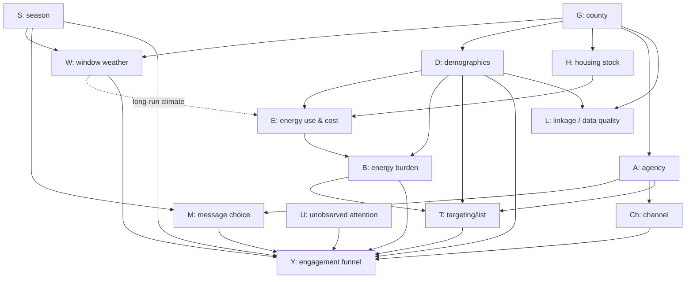

# Bayesian Model Inputs — Catalog and Causal Structure (DAGs)

**Date:** 2026-07-08
**Purpose:** Enumerate every input available to Bayesian models in this project, describe each one, and lay out the causal relationships (DAGs) needed to design the next model series. Companion to [`20260707_2325_bayesian_modeling_review_summary.md`](20260707_2325_bayesian_modeling_review_summary.md).
**Sources:** live schema doc ([`20260513_1508_database_schema.md`](20260513_1508_database_schema.md)), weather design ([`20260707_1551_campaign_weather_design.md`](20260707_1551_campaign_weather_design.md)), model loaders in `src/bayesian_models/`, enrichment scripts in `scripts/`, and `BAYESIAN_MODELING_PROGRESSION.md` (H1–H22).
**Caveat:** mongod was not running when this was written, so coverage notes come from the schema doc and code, not live sampling.

---

## 1. Data landscape — grains and join keys

Every model matrix is assembled from four grains. Getting the grain right *before* choosing predictors prevents the most common hierarchical-model mistake (treating campaign-level variation as if it had participant-level sample size).

| Grain | Collection(s) | Key | Rows | What varies here |
|---|---|---|---:|---|
| **Exposure** (person × send) | `exposures` | `(participant_id, campaign_id)` | ~344k | Outcomes (open/click/reply/opt-out), send-time energy snapshot |
| **Participant** (person) | `participants` | `participant_id` (email/phone) or `_id` | ~14.4k | Demographics, residence, thermal physics, linkage quality |
| **Campaign** (send event) | `campaigns` | `campaign_id` (UUID) | ~160 | Channel, message types, agency, timing, cost, **weather** |
| **Parcel** (building) | `<County>CountyDemographic/Residential/ElectricalDB/ThermalLoads` | `parcel_id` (per county) | varies | Raw demographics, structure, consumption series |

Join paths:

```
exposures.participant_id ──→ participants.participant_id      (natural key; participant_oid = surrogate FK)
exposures.campaign_id    ──→ campaigns.campaign_id
participants.linkage.{county_key, parcel_id} ──→ <County>* collections   (resolve names via CountyKeys)
applications.participant_match.participant_id ──→ participants
applications.attribution.likely_campaigns[].campaign_id ──→ campaigns
```

Conversions live in `applications` (canonical, 615 docs; `applicants` is legacy — don't use).

---

## 2. Input catalog

Legend for **Used by**: M01–M05 = numbered models, CM = click_model(_02), ME = messaging_effectiveness, — = available but consumed by no model yet.

### 2.1 Outcome variables (the Y's)

| Variable | Source path | Type | Description | Used by |
|---|---|---|---|---|
| `opened` | `exposures.email_engagement.opened` | binary | Email open (pixel-based; undercounts) | M01–M03, ME stage 1 |
| `clicked` (email) | `exposures.email_engagement.clicked` | binary | Email link click | M04, CM, ME stage 2 |
| `clicked` (text) | `exposures.text_engagement.clicked` | binary | Text link tap (added 2026-05-13) | — |
| `replied` / engaged | `exposures.text_engagement.replied` | binary | Text reply — strongest engagement short of converting | — |
| `opted_out` | `exposures.text_engagement.opted_out` | binary | Negative outcome; terminal state | — |
| `unified_status` | `exposures.unified_status` | ordinal-ish | `opted_out/undeliverable > engaged > clicked > received > no_engagement` (also stray `converted`, `negative_response`) | — |
| `application` | `applications` doc exists for participant | binary/event | Canonical conversion (submitted form), with `entry_date` timestamp | — |
| `approved program` | IMPACT report CSVs (exports), roll-up column | binary | Downstream program approval; ~81.5% of matched Text75-84 participants (Jun 15 analysis) | — |

**Design note:** these form a funnel — `sent → delivered → opened → clicked → applied → approved` — and each stage is a valid outcome. Modeling a later stage conditional on an earlier one (e.g. click given open) conditions on a post-treatment variable; see §4.5.

### 2.2 Treatment / campaign-design variables

| Variable | Source path | Type | Description | Used by |
|---|---|---|---|---|
| `channel` | `campaigns.channel` | cat (4) | email / text / mailer / letter (legacy text_morning/evening) | filter only |
| `message_types` | `campaigns.message_types` | multi-label (6) | urgency_deadline, savings_financial, relief_reassurance, informational, personalized_qualified, motivational_struggle. One-hot additive treatments | M04 |
| `message_type` (ME taxonomy) | regex on campaign name | cat (7) | cost_framing, savings_framing, urgency, personalization, improvement, event, other | ME |
| `message_body` | `campaigns.message_body` | text | Full text-campaign body — raw material for future NLP features (length, $ amounts, deadline mentions) | — |
| `subject`, `from_name` | `campaigns.subject` … | text | Email envelope features | — |
| `agency` | `campaigns.agency` | cat | Sending agency (MVCAP, COAD, IMPACT, WCP…) — also a grouping factor | — |
| `sent_at` | `campaigns.sent_at` | datetime | Send timestamp → month (season), day-of-week, hour | ME (month, dow) |
| `cost_per_send`, `total_cost` | `campaigns.*` | float | Economics; enables cost-per-conversion posteriors | — |
| campaign `statistics.*` | `campaigns.statistics` | counts | Cached aggregates (total_sent, opened, clicked, receive_rate…). **Cache — recompute from exposures when accuracy matters** | — |

### 2.3 Weather (campaign-level, embedded July 2026)

All computed over `[sent_at − 5d, sent_at]` (6 days / up to 144 hours), dominant recipient county centroid, Open-Meteo archive. `weather.status ∈ {ok, no_send_date, no_county, fetch_failed}` — filter to `ok`.

| Variable | Path | Description |
|---|---|---|
| `temp_mean_f/min/max` | `weather.temp_f.*` | Window temperature summary |
| `hdd_base65` | `weather.degree_days.hdd_base65` | Σ max(0, 65 − Tmean) — heating demand over window |
| `cdd_base65` | `weather.degree_days.cdd_base65` | Σ max(0, Tmean − 65) — cooling demand |
| `freezing_days`, `hot_days` | `weather.extremes.*` | Days with min < 32°F / max > 90°F (did an extreme occur) |
| `freezing_hours`, `hot_hours` | `weather.extremes.*` | Hourly counts below/above threshold (how long it lasted) |
| `window_hours` | `weather.extremes.window_hours` | Denominator for hour fractions (144 when full) |
| `county_recipient_share` | `weather.county_recipient_share` | Fraction of recipients in the dominant county — a **measurement-quality weight** (COAD campaigns ≈ 0.27; single-county ≈ 1.0) |

No model consumes weather yet. Key constraint: weather varies at the **campaign** grain (~153 clusters), so its effective N is campaigns, not exposures. HDD/CDD and temp_mean are nearly collinear in Ohio winters — pick one temperature axis plus one extremes axis.

### 2.4 Participant demographics (`participants.demographics.*`)

Denormalized from `<County>CountyDemographic`; Franklin enriched Jan 2026 with the IMPACT purchase file.

| Variable | Type | Description | Used by |
|---|---|---|---|
| `estimated_income` | float $ | Vendor-modeled household income | CM (as `income`) |
| `income_level` | ordinal 1–9 | Income tier code | M02–M04 (z), M05 (categorical index) |
| `household_size` | float | Members in household (`md_householdsize` upstream) | M02, M03 |
| `total_energy_burden` | float % | Energy cost / income × 100 — **derived ratio**, see §4.2 | M02–M04, CM |
| `energy_burden_kwh` / `energy_burden_gas` | float % | Electric-only / gas-only burden components | — |
| `annual_kwh_cost` | float $ | Annual electricity cost | M03 (z), M05 (÷12 → monthly, z) |
| `annual_gas_cost` | float $ / null | Annual gas cost (−1/null = no gas) — doubles as a **dual-fuel flag** (H6) | — |
| `owner_age` | int | Age of first individual (two-year increments upstream) | — (Franklin coverage) |
| `presence_of_children` / `presence_of_senior` | bool | Household composition flags | — (Franklin) |
| `number_of_adults` | int | Adults in household | — (Franklin) |
| `marital_status` | cat | Normalized marital status | — (Franklin) |
| `age_bracket`, `home_owner`, `dwelling_type` | cat | Sparse legacy slots — mostly null | — |
| `estimated_home_value` | int $ | On `FranklinCountyDemographic` only (not yet denormalized to participants) | — |
| `mobile` present | bool | Phone availability — H4, and a **channel-eligibility selection variable** | — |

### 2.5 Residence / structure (`participants.residence.*`, `<County>CountyResidential`)

| Variable | Type | Description | Used by |
|---|---|---|---|
| `living_area_sqft` | float | Living area (H7: bigger home → bigger bills → engagement) | — |
| `year_built` / `house_age` | int | ⚠ upstream `age` field is sometimes year (>1800), sometimes age (<200) — normalize | CM_02 (`house_age`) |
| `story_height` | float | Stories (1.0, 1.5, 2.0…) | — |
| `rcn` | float $ | Replacement cost new — structure-value proxy | — |
| `bedrooms/bathrooms/half_baths/rooms_total` | int | Mostly null in current data | — |
| `heat_type`, `air_conditioning` | cat | H9: electric-heat homes have most winter savings potential; mostly null today | — |
| `construction_quality`, `garage_size` | cat/int | Sparse | — |
| `census_tract` | str | Spatial unit for H21–H22 (CAR models); sparse | — |
| `energy_percentile` | int 0–100 | Within-county consumption percentile (enrichment field on Residential) — already used for campaign *targeting*, which makes it a confounder for those campaigns | — |

### 2.6 Energy behavior & send-time snapshot

| Variable | Source | Type | Description | Used by |
|---|---|---|---|---|
| `energy_snapshot.annual_cost` | participants | float $ | Total energy cost captured at first send | M01 (z) |
| `energy_snapshot.annual_savings` | participants | float $ | Modeled savings potential — the number quoted in message copy (H2) | ME (`savings_std`) |
| `monthly_cost`, `daily_cost`, `kwh_annual` | participants | float | Cost restatements / usage | ME (`monthly_cost_std`, `kwh_std`) |
| `energy_at_send.*` | exposures | float | Same shape, frozen per exposure — use this (not participant snapshot) for multi-campaign panels | — |
| `time_series_elec` | `<County>ElectricalDB` | array | Monthly kWh time series → volatility (H17), summer/winter ratio (H18) | — |
| `monthly_averages/maximums/minimums` | ElectricalDB | array[12] | Seasonal shape features | — |
| gas series | `CuyahogaGasDB` | array | Cuyahoga only | — |

### 2.7 Thermal physics (`participants.thermal.*`, `<County>ThermalLoads`)

The Gen-1 → Gen-2 bridge: physical heating/cooling sensitivity per building.

| Variable | Type | Description |
|---|---|---|
| `kwh_hl_slope` | float | kWh per heating-degree unit — **heating sensitivity** (H19). Electric-heat homes have large slopes |
| `kwh_cl_slope` | float | Cooling sensitivity (AC response) |
| `kwh_hl_intercept` / `kwh_cl_intercept` | float | Weather-independent baseload estimate |
| `kwh_hl_r2` / `kwh_cl_r2` | float 0–1 | Regression fit quality — H20 (predictable homes) and a **precision weight** for the slopes |
| `kwh_hl_cl_loads`, `gas_hl_cl_loads` | array | Per-month deconvolved heating/cooling consumption |

`kwh_hl_slope × window HDD` is a per-participant × per-campaign **dose**: how much the weather recipients just experienced actually hit *their* bill. This interaction is the most physically-grounded predictor available and no model has touched it.

### 2.8 Grouping factors (hierarchy levels)

| Factor | Levels | Where | Role |
|---|---|---|---|
| `county` | ~16–25 | `participants.linkage.county_key` | Random intercepts (M04 does this); carries climate + demographics + agency coverage |
| `campaign` | ~160 | `exposures.campaign_id` | Random intercepts (ME does this); the level where weather/message/timing live |
| `agency` | ~6 | `campaigns.agency` | Coarse cluster above campaign; design-style differences |
| `zip` / `city` | many | participants/exposures | Finer geography (ME uses location_idx) |
| `census_tract` | many | residence | For spatial CAR (H21–H22); sparse |
| `utility` | few | ME derived | First token of campaign name |

⚠ `county_key` spelling drift: "Franklin" vs "FranklinCounty" — normalize before indexing.

### 2.9 Conversion-side inputs (`applications`)

| Variable | Path | Description |
|---|---|---|
| `self_reported.age/household_income/household_members` | applications | Form-reported truth — compare against vendor `estimated_income` for measurement-error modeling |
| `self_reported.housing_status/pre_1978_home/…` | applications | Eligibility-relevant; sparse |
| `attribution.utm.*` | applications | UTM source/medium/campaign parsed from landing URL |
| `attribution.likely_campaigns[]` | applications | `{campaign_id, confidence 0.7–0.95, method: utm_direct/date_window/county_exposure/same-day-click}` — probabilistic edge from conversion back to campaign |
| `participant_match.{match_method, match_confidence}` | applications | Join quality to participants |
| `entry_date` | applications | Conversion timestamp — enables time-to-event framing |

### 2.10 County aggregates (`CountySummaries`)

Pre-computed per-county context: income distribution bins (extreme/severe/near/above poverty), median/avg income, avg energy burden, LMI vs non-LMI parcel counts, monthly LMI/non-LMI consumption arrays. Useful as **group-level predictors** on county random effects (a McElreath "varying effects with group predictors" move) rather than per-row features.

### 2.11 Selection & data-quality variables (model them, don't just filter)

| Variable | Path | Why it matters |
|---|---|---|
| `linkage.method` / `linkage.confidence` | participants | How the person was tied to a parcel (email/phone/address/name; 0–1). Parcel-derived predictors are **missing-not-at-random** where linkage failed |
| `data_quality.*` (`has_demographics`, `completeness_score`, `analysis_ready`) | participants | Filtering on `analysis_ready` conditions on data-vendor coverage → selection effects (§4.5) |
| `county_recipient_share` | campaigns.weather | Weather measurement quality per campaign |
| `kwh_hl_r2` | thermal | Slope reliability |
| `match_confidence`, attribution `confidence` | applications | Edge uncertainty for conversion outcomes — usable as weights or in a measurement model |

---

## 3. Variables named in the roadmap but not yet in usable shape

From `BAYESIAN_MODELING_PROGRESSION.md` (H1–H22): `mobile` availability (H4), gas/dual-fuel flag (H6 — derivable now from `annual_gas_cost`), `heat_type`/`air_conditioning` (H9 — mostly null), rooms/bedrooms (null), usage volatility and summer/winter ratio (H17–H18 — **derivable** from `time_series_elec`, needs feature engineering), census-tract spatial structure (H21–H22 — sparse). Everything else in H1–H20 is present today.

---

## 4. Causal structure — DAGs for the next model series

### 4.1 Node glossary

| Symbol | Meaning | Grain |
|---|---|---|
| **S** | Season / calendar time (month, dow of `sent_at`) | campaign |
| **G** | County (geography: climate zone, demographics mix, agency territory) | participant/campaign |
| **W** | Window weather (HDD, freezing_hours, …) | campaign |
| **A** | Agency (design habits, program rules) | campaign |
| **M** | Message treatment (message_types, body, subject) | campaign |
| **Ch** | Channel (email/text/mailer) | campaign |
| **D** | Demographics (income, household size, age, children/senior) | participant |
| **H** | Housing (sqft, age, heat type, RCN) | participant |
| **E** | Energy use/cost (kWh, annual cost, thermal slopes) | participant |
| **B** | Energy burden (≡ E-cost / D-income) | participant |
| **T** | Targeting (who got put on the list) | exposure |
| **Y₁…Y₄** | Open → Click → Apply → Approved | exposure |
| **L** | Linkage/data-quality (selection into analyzable data) | participant |
| **U** | Unobserved (attention, attitudes, phone/email habits) | participant |

### 4.2 Structural backbone (holds for every model)



Reading it:

- **B is a deterministic child of E and D** (burden = cost/income). Never treat income, kWh cost, and burden as three independent predictors in a *causal* model — "the effect of burden holding income and cost constant" is undefined. Pick one parameterization per estimand: burden alone (policy-relevant composite), or income + cost (mechanism separation). For pure prediction the collinearity only hurts interpretability, not fit.
- **T (targeting) is the quiet confounder.** Campaign lists were built from these same county collections — e.g. `energy_percentile` targeting and IMPACT eligibility rules. Anywhere list construction depended on D or B, "who was exposed" is not random, and campaign-level comparisons inherit that.
- **W → E is long-run climate, not the 6-day window.** Window weather cannot cause annual burden (it's an annual figure computed long before the send). So W → Y is a *direct* salience/priming path — clean to isolate.
- **County G is a fork feeding almost everything** — the strongest argument for county varying intercepts in every model (M04 already does this).

### 4.3 Estimand-specific DAGs

**(a) Weather → engagement** (the natural experiment; new territory)

```
S ──→ W ──→ Y          Estimand: direct W → Y (salience of cold/heat)
S ────────→ Y          Backdoor: W ← S → Y  (winter sends differ seasonally)
G ──→ W                Backdoor: W ← G → {D,B} → Y  (cold counties are different counties)
G ──→ D/B ──→ Y
```

*Adjustment set: {S, G}.* Practically: month (or a cyclic spline on send date) + county varying intercepts; weather coefficients at the campaign level (~150 clusters — keep the weather block to 2–3 predictors, e.g. `hdd_base65` + `freezing_hours`). Weight or robustness-check by `county_recipient_share`.
*Best interaction:* `W × kwh_hl_slope` (campaign HDD × participant heating sensitivity) — tests "weather works through *felt* bills," a sharper hypothesis than a main effect, and it varies at the exposure grain so it isn't starved for sample size.

**(b) Message type → engagement** (M04's estimand, extendable)

```
A ──→ M ──→ Y          Backdoors: M ← A → Y   (agency style)
A ──→ T ──→ Y                     M ← S → Y   (seasonal message choice: "Winter", "LastDay")
S ──→ M                           M ← A → T → Y (different lists get different messages)
```

*Adjustment set: {A, S, T-proxies}.* M04 adjusts for county + demographics; adding agency (or campaign-family) effects and send-month would close the remaining backdoors. Message types are multi-label, so effects are additive by assumption — worth a posterior check on common co-occurring pairs.

**(c) Text campaign → IMPACT application** (treatment/control with EGE no-text group)

```
List(T) ──→ Text ──→ Y₃ (apply)     Text assignment ≈ list construction,
D,B ──→ List(T)                      so D,B confound unless lists were equivalent
D,B ──→ Y₃
G ──→ everything
```

*Adjustment:* the Jun-15 overlap analysis found text recipients convert ~4× — but the control group must be checked for covariate balance (income, burden, county) before reading that causally. With balance, a simple logistic + county effects suffices; without, adjust for D, B, G directly. Attribution edges carry confidence 0.7–0.95 — propagate as weights or a misclassification term rather than treating attribution as certain.

**(d) The funnel as a joint model**

```
sent ──→ received ──→ Y₁ open ──→ Y₂ click ──→ Y₃ apply ──→ Y₄ approved
              (per-stage predictors can differ; campaign REs per stage as in ME)
```

Sequential logits (ME's two-stage structure, extended). Each stage conditions on surviving the previous stage — fine for *stage-specific rates*, but see the collider warning below before interpreting stage-2+ coefficients causally.

### 4.4 Moderators worth building (interaction candidates)

| Interaction | Hypothesis | Grains crossed |
|---|---|---|
| `hdd × kwh_hl_slope` | Weather salience scales with heating sensitivity | campaign × participant |
| `savings_financial × annual_savings` | Savings framing works when there are savings to cite | campaign × participant |
| `urgency_deadline × S` | Urgency framing near program deadlines | campaign × campaign |
| `B × income_level` | H14: burden bites differently across income (M05's varying slopes generalize this) | participant × participant |
| `Ch × mobile/email availability` | Channel effect gated by reachability | campaign × participant |

### 4.5 Colliders and selection traps specific to this data

1. **Conditioning on open (stage 2).** `U (attention) → open ← M (message appeal)`. Among openers, U and M become negatively correlated (Berkson): click-given-open coefficients are *conditional* effects and can even flip sign vs. total effects. Report total click-through alongside click-given-open.
2. **`analysis_ready` filtering.** `D → L ← G` — linkage success depends on vendor coverage and demographics. Filtering to linked participants selects on L; parcel-derived predictors (H, E, thermal) exist *only* for that stratum. State conclusions as "among linkable participants," or model L explicitly.
3. **Denormalized burden ≈ post-outcome measurement.** `demographics.*` snapshots were written at enrichment time, not send time; for panel models across a year of campaigns, prefer `exposures.energy_at_send` where populated.
4. **Campaign `statistics` are caches** — never use as outcomes; recompute from exposures.
5. **Duplicate exposures exist** (`(participant_id, campaign_id)` not unique) — dedupe before Bernoulli modeling or rows are silently double-weighted.

---

## 5. Assembly cookbook (per-estimand model matrix)

```
Weather → engagement:
  exposures (channel filter, dedupe) 
    ⋈ campaigns [message_types, sent_at→month, agency, weather.* where status='ok']
    ⋈ participants [demographics z-scores, linkage.county_key normalized, thermal.kwh_hl_slope]
  grains: y at exposure; W,M,S at campaign; D,B,slope at participant; county index at participant

Text → conversion:
  participants (Text75-84 cohort ∪ EGE control) 
    ⋈ applications via participant_match (+ attribution confidence)
    ⋈ demographics/county for adjustment
  outcome: application exists (or approved roll-up from IMPACT export)

Funnel:
  exposures ⋈ campaigns ⋈ participants, sequential outcomes from
  email_engagement/text_engagement + applications via attribution.likely_campaigns
```

Standardize continuous predictors in-model (existing loaders already persist `_scaler_params` — keep that convention). Non-centered parameterization for county/campaign effects (M04/M05 pattern).

---

## 6. Recommended priorities

1. **Weather → engagement with the `hdd × kwh_hl_slope` dose interaction** — unique to this dataset (physics + engagement in one place), weather is exogenous given {S, G}, and both halves of the interaction already exist in the DB. Extends M04's template directly.
2. **Text75-84 → IMPACT conversion vs. EGE control** — the only design with a real control group; a covariate-balance check is the first deliverable.
3. Whichever direction goes first, **fit M01 on the way** — nothing has ever been trained, and a fitted baseline is the reference every LOO comparison needs.
